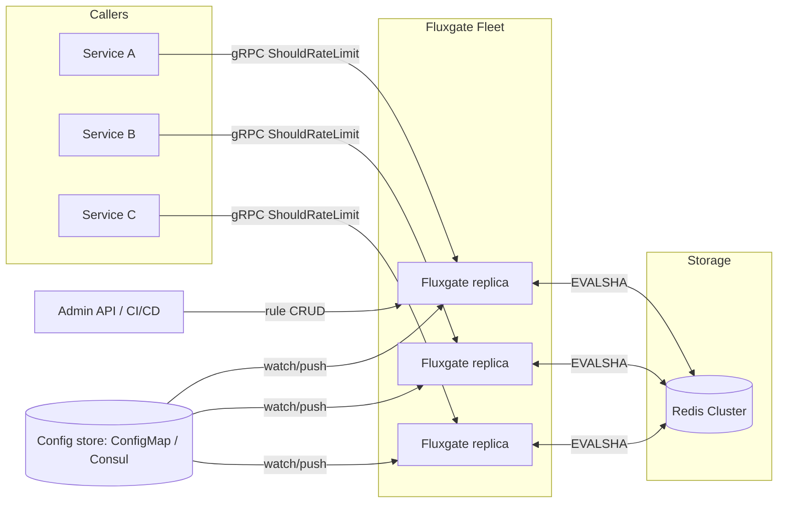
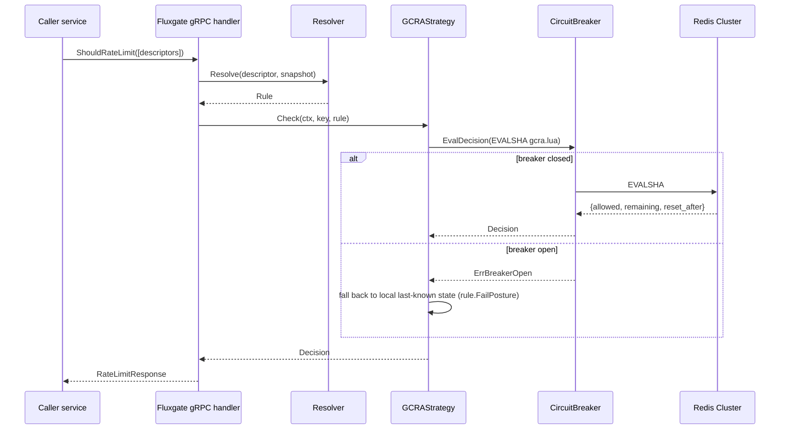
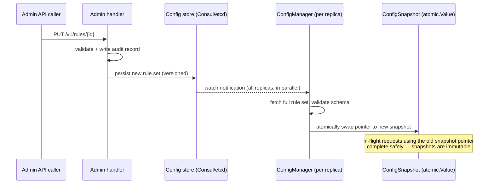
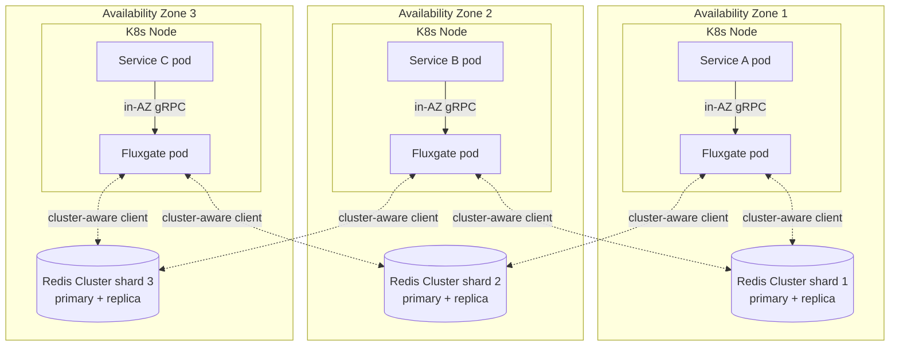
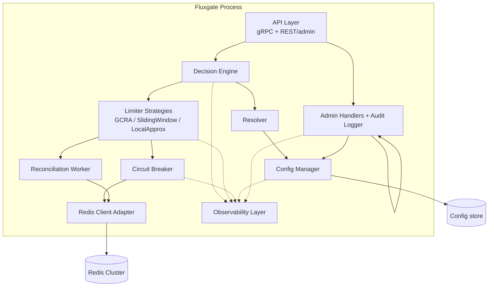

# Fluxgate — Distributed Rate Limiter

## Technical Design Document

| | |
|---|---|
| **Status** | Draft — pre-implementation |
| **Owner** | Platform Infrastructure |
| **Reviewers** | Backend Guild, SRE |
| **Version** | 0.1.0 |
| **License (target)** | Apache 2.0 |

> This document is the design contract for Fluxgate. It is written so that a
> senior engineer who has never seen the codebase can implement it end to end
> without needing to ask a clarifying question. Every non-obvious decision is
> justified: what we chose, what we rejected, and why. Where a decision has a
> real cost, that cost is stated rather than hidden.

### Table of Contents

1. [Problem Statement](#1-problem-statement)
2. [Functional Requirements](#2-functional-requirements)
3. [Non-Functional Requirements](#3-non-functional-requirements)
4. [Business Requirements](#4-business-requirements)
5. [Performance Goals](#5-performance-goals)
6. [Scalability Goals](#6-scalability-goals)
7. [Availability Goals](#7-availability-goals)
8. [Latency Goals](#8-latency-goals)
9. [Security Requirements](#9-security-requirements)
10. [High-Level Architecture](#10-high-level-architecture)
11. [Low-Level Architecture](#11-low-level-architecture)
12. [Components](#12-components)
13. [Package Structure](#13-package-structure)
14. [Class / Type Responsibilities](#14-class--type-responsibilities)
15. [Sequence Diagrams](#15-sequence-diagrams)
16. [Deployment Diagram](#16-deployment-diagram)
17. [Component Diagram](#17-component-diagram)
18. [Redis Data Model](#18-redis-data-model)
19. [API Design](#19-api-design)
20. [Configuration Strategy](#20-configuration-strategy)
21. [Thread Safety Strategy](#21-thread-safety-strategy)
22. [Concurrency Strategy](#22-concurrency-strategy)
23. [Failure Recovery Strategy](#23-failure-recovery-strategy)
24. [Retry Strategy](#24-retry-strategy)
25. [Observability Strategy](#25-observability-strategy)
26. [Metrics](#26-metrics)
27. [Logging](#27-logging)
28. [Alerting](#28-alerting)
29. [Horizontal Scaling](#29-horizontal-scaling)
30. [Kubernetes Deployment](#30-kubernetes-deployment)
31. [Docker Deployment](#31-docker-deployment)
32. [Trade-offs](#32-trade-offs)
33. [Future Improvements](#33-future-improvements)
34. [Open Questions](#34-open-questions)
35. [Risks](#35-risks)

---

## 1. Problem Statement

Every service that receives traffic eventually needs to answer one question
under load: *should this request be allowed to proceed right now?* In a
monolith this is a local counter. In a distributed system — dozens of
replicas behind a load balancer, scaling up and down, spread across
availability zones — a counter kept in one process's memory is not a rate
limit, it's a per-replica guess. A client hitting three replicas round-robin
can burst to 3× the intended limit while every individual replica honestly
believes it is enforcing the configured rate correctly.

Rate limiting also isn't one problem, it's several wearing the same name:

- **Protecting a backend from overload** (a downstream database, a
  third-party API with its own quota, a CPU-bound compute path).
- **Enforcing a product/business quota** (100 requests/minute on the free
  tier, 10,000 on enterprise) — correctness here has revenue and contractual
  consequences, not just stability ones.
- **Defending against abuse** (credential stuffing, scraping, a
  misconfigured client retry-storming an endpoint).

These three have different tolerances for staleness, different key
dimensions (IP vs. API key vs. tenant vs. route), and different failure
postures (abuse defense should fail closed; a soft product quota probably
should not take an outage as its excuse to reject paying customers).

Existing options force an uncomfortable choice. Local (in-process) limiters
are fast but not distributed — they solve nothing for the multi-replica case
above. Rolling your own on top of a shared Redis instance is a well-worn path
that almost every company re-implements slightly differently, usually
starting from a fixed-window counter that everyone later discovers has a 2×
boundary-burst bug, and usually without circuit breaking, without a
descriptor/override model, and without the operational surface (metrics,
config hot-reload, admin API) that a shared piece of infrastructure needs
once more than one team depends on it.

Fluxgate exists to be that shared piece of infrastructure, built once,
correctly, with the trade-offs made explicit and configurable rather than
implicit and discovered in production.

**What Fluxgate is:** a purpose-built network service (with client
libraries) that answers "allow or deny" for a set of rate-limit descriptors,
backed by a shared store, with sub-millisecond p50 latency, graceful behavior
when that store is unavailable, and a configuration model expressive enough
to cover per-tenant, per-route, and per-client-identity limits without code
changes.

**What Fluxgate is not:** a general-purpose API gateway, an authentication
system, or a queueing/backpressure system. It answers one question
(allow/deny, and if deny, when to retry) and answers it fast and correctly.

---

## 2. Functional Requirements

| # | Requirement |
|---|---|
| F1 | Given one or more rate-limit **descriptors** (ordered key/value pairs, e.g. `[{tenant: acme}, {route: /v1/orders}]`), return an allow/deny decision plus remaining quota and, if denied, a `retry_after` duration. |
| F2 | Support checking **multiple descriptors in a single call** (a request may be subject to a per-IP limit *and* a per-tenant limit *and* a global limit simultaneously); the call denies if **any** applicable limit is exceeded, and reports which one(s). |
| F3 | Support **hierarchical rule configuration**: a global default, overridable per tenant, overridable per tenant+route, with most-specific-match-wins semantics — without requiring a rule to be pre-declared for every combination. |
| F4 | Support at minimum these limiter algorithms, selectable per rule: **GCRA** (default), **sliding window counter** (approximate, cheaper). Fixed-window is available for migration compatibility but flagged as discouraged (see [§32](#32-trade-offs)). |
| F5 | Rules are **hot-reloadable** without restarting the process and without dropping or double-counting in-flight requests. |
| F6 | Provide a **client library** (thin gRPC wrapper) for at least Go, Java, and Python, so the service is consumable by both the JVM and Go/Python parts of a polyglot estate. |
| F7 | Provide a **local, in-process fallback mode** per rule (fail-open or fail-closed) for when the shared store is unreachable. |
| F8 | Expose an **admin API** to create/update/delete rate-limit rules and to inspect current usage for a given descriptor (support debugging "why am I being throttled"). |
| F9 | Support **multi-tenancy** as a first-class descriptor dimension — one tenant's traffic must never be able to exhaust another tenant's quota bucket. |
| F10 | Support a **dry-run / shadow mode** per rule: compute the decision and emit metrics/logs, but always return "allow" — for safely rolling out new limits. |

---

## 3. Non-Functional Requirements

| # | Requirement |
|---|---|
| NF1 | p99 added latency ≤ 5 ms, p50 ≤ 1 ms, for the hot-path `ShouldRateLimit` call, measured at the client, excluding network RTT to the caller's own upstream. |
| NF2 | Horizontally scalable with no coordination between Fluxgate replicas — any replica can answer any request. |
| NF3 | Survives loss of the backing store (Redis) without cascading failure into caller services (see [§23](#23-failure-recovery-strategy)). |
| NF4 | No single point of failure in the deployed topology (Redis itself is deployed as a Cluster/HA topology, not standalone). |
| NF5 | Configuration changes propagate to all replicas within a bounded, observable window (target: ≤ 10 s at p99). |
| NF6 | The service is stateless from an orchestration standpoint — no local disk state required to serve traffic, so replicas are freely interchangeable and disposable. |
| NF7 | Multi-tenant isolation: no descriptor's counter key can collide with another tenant's, even under hash collisions in user-supplied labels (see [§18](#18-redis-data-model)). |
| NF8 | Backward-compatible API evolution — the gRPC contract follows proto best practices (no field renumbering/removal) so client and server can be deployed independently. |

---

## 4. Business Requirements

Fluxgate is designed to be adopted as **shared infrastructure across many
teams**, not owned code inside one service. That changes what "done" means:

- **Zero-code-change onboarding.** A team adopts Fluxgate by adding a
  sidecar/service call and a YAML rule, not by importing a library into
  business logic and hand-rolling the descriptor plumbing. This is what
  makes it *infrastructure* rather than *a shared utility class*.
- **Blast-radius containment.** Because every request-serving service will
  eventually depend on this, an outage or bug in Fluxgate is an outage
  multiplier across the company. Every failure-mode decision in this
  document is made with that multiplier in mind — this is why fail-open is
  the *configurable default* for non-critical rules rather than a hardcoded
  posture either way.
- **Auditability for revenue-relevant limits.** Where a rule enforces a
  billing tier (e.g., "free tier: 100 req/min"), rule changes go through the
  admin API's audit log, not a config file edited by hand in prod — this is
  a paper trail requirement, not a technical one.
- **Vendor/runtime neutrality.** Ships as a container image and a set of
  client libraries; no dependency on a specific cloud provider's managed
  rate-limiting product, so it works identically on AKS, EKS, GKE, or
  on-prem Kubernetes.
- **Predictable operating cost.** Redis memory usage per limiter key must be
  small and bounded (see [§18](#18-redis-data-model)) — this is a direct
  infrastructure cost line item once the descriptor cardinality reaches
  millions of active keys (e.g., per-user limits at consumer scale).

---

## 5. Performance Goals

| Metric | Target | Rationale |
|---|---|---|
| Throughput per replica | ≥ 50,000 `ShouldRateLimit` req/s sustained on 2 vCPU | Sized so that a small fleet (3–6 replicas) covers a mid-size platform's aggregate request volume without the rate limiter itself becoming the scaling bottleneck. |
| CPU cost per check | O(1) — no per-request allocation beyond the request/response structs, no scan/loop over historical timestamps | Rules out sliding-window-log style algorithms, which are O(N) in requests-per-window ([§32](#32-trade-offs)). |
| Redis round-trips per check | Exactly 1 when all of a request's descriptors resolve to keys on the same Redis Cluster shard (the common single-descriptor case); at most 1 **per distinct shard touched**, issued as concurrent per-shard pipelines and joined before responding, when descriptors span multiple shards — never sequential | Redis Cluster forbids a single Lua script (or `MULTI`/`EXEC`) from touching keys on more than one slot, so a request whose descriptors land on different shards cannot be collapsed into one physical round trip ([§11.1](#111-request-path-exact-mode-the-default)); sequential per-shard round trips would multiply tail latency by shard count, so Fluxgate fans them out concurrently and bounds tail latency to the *slowest touched shard*, not the sum. |
| Memory per active limiter key | ~40–60 bytes (a single Redis value + TTL metadata) | GCRA needs only one stored value (see [§18](#18-redis-data-model)), unlike algorithms needing a counter *and* a timestamp, or a full request log. |

---

## 6. Scalability Goals

- **Stateless data plane.** Fluxgate replicas hold no authoritative state;
  all authoritative counters live in Redis. This means the data plane scales
  purely horizontally — add replicas, no rebalancing, no leader election.
- **Redis Cluster as the scale-out axis for storage.** Counters are sharded
  across Redis Cluster hash slots by descriptor key. A single Redis
  primary's throughput ceiling (roughly hundreds of thousands of ops/sec) is
  therefore not a hard ceiling on the system — it's a ceiling per shard,
  and shard count scales with cluster size.
- **Hot-key mitigation is a first-class design concern, not an
  afterthought.** A single extremely high-traffic descriptor (e.g., a global
  "per-IP" limit behind a NAT gateway serving thousands of users) can pin one
  Redis Cluster slot. Fluxgate supports **key sharding**: a hot descriptor's
  logical limit of `N` is split across `k` sub-keys of `N/k` each, chosen by
  a fast client-side hash of a monotonic counter, trading a small amount of
  fairness precision (a client could theoretically land favorably on a
  less-utilized sub-shard) for removing the single-slot bottleneck. This is
  opt-in per rule, because it adds a small amount of over-admission risk at
  the boundary between sub-keys.
- **Target scale envelope:** 10M distinct active descriptor keys, 500K
  `ShouldRateLimit` req/s aggregate, across a Redis Cluster of 6–12 shards
  and a Fluxgate fleet of 10–30 replicas. This is a design envelope, not a
  hard cap — see [§34](#34-open-questions) for what changes past it.

---

## 7. Availability Goals

| Target | Value |
|---|---|
| Fluxgate service SLA | 99.95% (≈ 4.4 minutes/month) |
| Effective availability of *protected* backends during a Redis outage | Unaffected for fail-open rules; degrades to "reject" for fail-closed rules (by design — see [§23](#23-failure-recovery-strategy)) |
| Redis Cluster SLA (dependency) | 99.9%, mitigated by Fluxgate's local fallback so Fluxgate's own SLA can exceed its dependency's |

The last row is the important one: Fluxgate is explicitly designed to have
**higher** availability than its own storage dependency, by degrading
gracefully rather than propagating the dependency's failure. This is the
entire justification for [§23](#23-failure-recovery-strategy) and the local
approximate-limiting mode in [§11](#11-low-level-architecture).

---

## 8. Latency Goals

| Percentile | Added latency budget (Fluxgate call only) |
|---|---|
| p50 | ≤ 2 ms |
| p90 | ≤ 4 ms |
| p99 | ≤ 8 ms |
| p99.9 | ≤ 20 ms (covers a Redis Cluster MOVED/ASK redirect or a GC pause) |

**Locality is honest, not assumed away.** An earlier draft of this section
claimed cross-AZ Redis calls were "out of scope," and separately claimed
Fluxgate's Kubernetes topology enforces same-AZ routing to Fluxgate — but
said nothing about *Fluxgate → Redis*, where it actually matters. That was
wrong, and the numbers above reflect the correction rather than repeating
the mistake.

Redis Cluster assigns each hash slot's primary to exactly one node in one
AZ, and that assignment is a cluster-management decision, not something a
calling Fluxgate replica controls or can route around. With shard primaries
spread round-robin across 3 AZs, a given replica's calls are same-AZ for
roughly 1 in 3 keys and cross-AZ (one extra intra-region hop, typically
0.5–2 ms in most cloud regions) for the rest — this is the *majority* case,
not a tail event, which is why it is reflected in p50/p90 above and not just
folded into p99.9. The p99.9 row is reserved for genuinely rare events
(a slot migration mid-request, a GC pause).

For rules where even this blended latency is unacceptable, two mitigations
are available, in order of preference:

1. **Local approximate mode** ([§11.2](#112-request-path-local-approximate-mode-opt-in-per-rule))
   removes Redis from the synchronous path entirely — near-zero added
   latency, at the cost of the bounded over-admission described there.
2. **Per-AZ Redis Clusters** (independent clusters, one per AZ, each holding
   only that AZ's share of a rule's limit — statically divided as
   `limit / az_count`, since AZ count is stable infrastructure topology
   rather than a fluctuating replica count, so unlike local-approximate mode
   this needs no dynamic reconciliation loop). This restores a hard
   same-AZ latency guarantee for exact-mode rules, at the cost of the same
   kind of bounded partition-imprecision local-approximate mode already
   accepts, just at AZ granularity instead of replica granularity, and is
   an explicit per-deployment opt-in, not the default topology in
   [§16](#16-deployment-diagram).

---

## 9. Security Requirements

- **mTLS for all data-plane traffic** (caller → Fluxgate, Fluxgate → Redis).
  In a service-mesh deployment (Istio/Linkerd) this is provided by the mesh
  sidecar; Fluxgate must not assume a mesh is present and must terminate TLS
  itself when it is not, rather than silently running plaintext.
- **Separate authN/authZ for the admin (control) plane vs. the data
  (check) plane.** The `ShouldRateLimit` RPC is called by every service on
  every request and must not carry per-call user-credential overhead beyond
  mTLS identity. The rule-mutation API is called rarely, by humans or CI/CD,
  and requires OAuth2 client-credentials or mTLS client-cert identity scoped
  to *which tenant's rules* the caller may modify — a service in tenant A's
  namespace must not be able to alter tenant B's limits.
- **No user-controlled string is ever concatenated into a Lua script.**
  Descriptor values are passed to Redis exclusively as `ARGV`/`KEYS`
  parameters to a pre-loaded, `SCRIPT LOAD`-registered script (invoked via
  `EVALSHA`). This eliminates a Lua-injection class of vulnerability that a
  naively templated script (`"redis.call('GET', 'rl:' .. tenant)"`) would
  otherwise open up.
- **Redis AUTH + TLS**, credentials sourced from a secret store (Key
  Vault/Vault/K8s Secret mounted as a file, never as a plaintext env var
  baked into an image or Helm values file).
- **Descriptor-key hashing to prevent cross-tenant collision** — see
  [§18](#18-redis-data-model) for why raw string concatenation is not safe
  enough on its own.
- **Rate-limit the admin API itself** (bootstrapping problem: the thing that
  enforces limits must not itself be an unlimited attack surface) using a
  small, hardcoded, non-configurable local limiter — deliberately *not*
  routed through the main data plane, to avoid a circular dependency during
  an incident.
- **Audit log** (immutable, append-only, shipped off-host) for every rule
  create/update/delete: who, when, what changed, previous value.
- **Cardinality-bounded labels on metrics** ([§26](#26-metrics)) — an
  unbounded label (e.g., raw IP address) on a Prometheus metric is a
  resource-exhaustion vector against the observability stack, not just an
  aesthetic problem.

---

## 10. High-Level Architecture

Fluxgate is a **centralized rate-limiting service** (in the same family as
Envoy's `ratelimit` sidecar and Kong's rate-limiting plugin), backed by
**Redis Cluster** as the shared source of truth, with an optional **local
approximate mode** to remove Redis from the synchronous path when a caller's
latency budget cannot tolerate a network hop.



**Why centralized service over embedded library:** an embedded library
(linked into every calling service) avoids a network hop, but it means every
consuming team owns an upgrade, owns a Redis client version, and a bug fix
requires N redeploys instead of one. Given the business requirement of
"zero-code-change adoption across many teams" ([§4](#4-business-requirements)),
a centralized service with a thin client stub is the correct trade: one
upgrade path, one place to fix a bug, one place to observe. The cost — a
network hop — is bounded and budgeted for explicitly in
[§8](#8-latency-goals), and removable per-rule via local approximate mode
when it isn't acceptable.

**Why Redis over a distributed database (Cassandra/DynamoDB) or a
coordination service (etcd/ZooKeeper):**

| Option | Why rejected |
|---|---|
| Cassandra / DynamoDB | Single-digit-millisecond typical latency is fine for general OLTP but eats most or all of the p99 budget in [§8](#8-latency-goals) before Fluxgate's own logic even runs. Also no native atomic read-modify-write-with-TTL primitive as ergonomic as a Lua script — would need conditional writes plus separate TTL management. |
| etcd / ZooKeeper | Built for low-write-rate configuration/coordination data (leader election, config), not for a workload that is, by definition, a write on every single request. Using them here would be workload/tool mismatch, and both explicitly document this as an anti-pattern. |
| Local-only (no shared store) | Fails NF2/F1 entirely — cannot enforce a *global* limit across replicas, which is the core problem this project exists to solve. Useful only as the fallback tier, not as the primary store. |
| Redis (Cluster) | Sub-millisecond typical latency, native key TTL (automatic cleanup of idle limiter keys — no GC job needed), Lua scripting gives atomic check-and-increment in one round trip, and it is the store every algorithm survey (Stripe, Cloudflare, Lyft/Envoy, Kong) converges on for exactly this workload — not because it's trendy, but because "single-key atomic mutation with TTL, sub-ms" is precisely the primitive this problem needs. |

---

## 11. Low-Level Architecture

### 11.1 Request path (exact-mode, the default)

1. Caller's client library builds a `RateLimitRequest` containing one or more
   descriptors (ordered label lists) and calls `ShouldRateLimit` over gRPC.
2. Fluxgate's gRPC handler resolves each descriptor against the current
   **immutable config snapshot** (see [§20](#20-configuration-strategy)),
   using most-specific-match: exact tenant+route rule, else tenant-level
   rule, else global default, else "no rule configured" (treated as
   unlimited/allow, logged at WARN so missing configuration is visible
   rather than silently permissive-by-accident).
3. For each resolved rule, Fluxgate computes a Redis key
   ([§18](#18-redis-data-model)). Redis Cluster restricts a single Lua
   script invocation (like `MULTI`/`EXEC`) to keys resident on **one hash
   slot** — it will not execute a script that touches keys on two different
   shards. A request's descriptors are therefore **grouped by owning shard**
   using the slot map the cluster-aware client already maintains, and
   Fluxgate issues **one pipelined batch of single-key `EVALSHA` calls per
   shard touched**, fanning those batches out **concurrently** (one goroutine
   per distinct shard, not per descriptor — see [§22](#22-concurrency-strategy)).
   In the common case — a single descriptor, or several descriptors that
   happen to hash to the same shard — this collapses to exactly one round
   trip; when descriptors span shards (typically 1–3 for a realistic rule
   set), it is one round trip per shard, run in parallel, joined before
   the next step.
4. Each shard's Lua script implements GCRA independently and atomically for
   its own key(s): it reads the stored theoretical arrival time (TAT) for
   the key (or treats an absent key as "never throttled before"), computes
   whether the current request's arrival is within the allowed emission
   interval ([§11.4](#114-gcra-decision-formula)), and — atomically, in the
   same script — either advances the TAT (on allow) or leaves it untouched
   (on deny), setting a `PEXPIRE` on the key equal to the burst window so
   idle keys self-expire. Atomicity is per-key/per-shard, which is all GCRA
   ever needs — it does not require cross-shard atomicity, only that each
   individual descriptor's check-and-update is atomic.
5. Fluxgate aggregates the per-descriptor results once every shard's batch
   has returned: overall decision is `DENY` if **any** descriptor's limit
   was exceeded, `ALLOW` otherwise. Every descriptor's individual result
   (limit, remaining, reset time) is returned so the caller can surface
   `X-RateLimit-*` style headers.
6. Response returned to caller. Total added latency: one gRPC round trip +
   one Redis round trip **per distinct shard touched, executed
   concurrently** — bounded by the slowest touched shard, not by the sum,
   and equal to a single Redis round trip in the common single-shard case.

### 11.2 Request path (local approximate mode, opt-in per rule)

For rules marked `mode: local_approximate` in config:

1. Each Fluxgate replica maintains an **in-memory token bucket per
   descriptor key**, initially seeded with an equal fair-share allocation:
   `rule_limit / current_replica_count`.
2. The hot path checks and decrements this in-memory bucket — no network
   call, no Redis dependency, at all.
3. A background `ReconciliationWorker` goroutine, on a fixed tick (default
   2 s, configurable per rule), reports each replica's local consumption
   over the last interval and recomputes each replica's share for the next
   interval. The Redis-side data model backing this is specified in
   [§18.1](#181-local-approximate-mode-reconciliation-keys); the mechanics
   are:
   - **Demand reporting:** each replica writes its own observed local
     consumption `c_i` for the interval just ended.
   - **Share recomputation** (run identically, independently, by every
     replica against the same shared reconciliation data — no leader
     election needed, since the formula is deterministic given the same
     inputs): let `C = rule_limit` (requests/period), `total_demand =
     Σ c_i` across all *fresh* (non-stale) replicas. If `total_demand ≤ C`
     (no contention), every replica's next share is its own demand plus an
     even split of the unclaimed remainder, so an idle replica isn't
     starved if its traffic suddenly grows before the *following* tick. If
     `total_demand > C` (contention), shares are allocated **proportional
     to observed demand**: `share_i = C × (c_i / total_demand)`.
   - **Smoothing:** the applied share is an exponential moving average of
     the freshly computed proportional share and the previous share
     (`share_i(t) = α·proportional_share_i + (1−α)·share_i(t−1)`, default
     `α = 0.5`) to damp oscillation when demand shifts sharply between
     replicas from one tick to the next.
   - **Minimum floor:** every fresh replica's share has a configurable
     floor (default: `C / (10 × current_replica_count)`) regardless of its
     reported demand, so a replica that just came up with zero prior demand
     can still serve an initial burst instead of rejecting everything until
     its first reconciliation tick reports nonzero demand.
   - Because shares are always computed as a **partition of `C`** (they sum
     to exactly `C` every tick, floor included, by construction — the
     "even split of the unclaimed remainder" and the proportional-allocation
     branch both normalize to `C`), the design never *additively* grants
     more than `C` total capacity across replicas for a given completed
     tick.
4. `current_replica_count`, and which replicas are "fresh" for the demand
   sum above, are derived from the same heartbeat data in
   [§18.1](#181-local-approximate-mode-reconciliation-keys) — not from the
   Kubernetes API — keeping the reconciliation path storage-agnostic and
   avoiding a Kubernetes RBAC dependency Fluxgate otherwise wouldn't need.
   A replica missing `3` consecutive heartbeats (default `staleness_threshold`,
   ≈ 3 tick intervals) is excluded from the next `total_demand`/share
   computation and its previously-held share is folded back into the
   redistributable pool on the very next tick; a replica missing `5`
   consecutive heartbeats (default `hard_ttl`) has its demand/heartbeat
   entries actively removed rather than left to passively age out, so a
   permanently-scaled-down or crashed replica's stale entries cannot
   accumulate.

**Bounding the over-admission this trades away.** Because a reconciliation
tick's shares are computed *after the fact*, from the *previous* interval's
demand, a replica can consume up to its currently-held share for the
*entire* current interval even if global demand has, in that same window,
shifted entirely elsewhere. The worst case is bounded and single-interval:
in the pathological case where all demand instantaneously moves onto a
replica that held only the minimum floor share, the system can over-admit
by at most `C × (1 − floor_fraction)` for one reconciliation interval,
self-correcting on the next tick once that replica's real demand is
reported and reflected in the redistribution. This is a concrete,
testable bound (directly observable via `fluxgate_local_approx_drift_ratio`,
[§26](#26-metrics)) rather than an unquantified "it converges" claim, and it
scales down as the tick interval shortens or the floor fraction is lowered
— both configurable per rule as a latency-vs-precision dial distinct from
the mode's own opt-in latency-vs-precision trade.

This mode trades **precision for latency**: aggregate enforcement can
overshoot the configured limit, bounded as above, for at most one
reconciliation interval's worth of uneven demand distribution. This is an
explicit, documented, per-rule opt-in — never the default — because most
limits (billing tiers, abuse protection) care more about correctness than
about shaving off a network hop. It exists for the minority of rules where
the caller's own latency SLA cannot absorb even a same-AZ Redis round trip.

### 11.3 Why GCRA over token bucket, sliding window counter, sliding window log, and fixed window

| Algorithm | Memory per key | Precision | Burst handling | Verdict |
|---|---|---|---|---|
| Fixed window counter | 1 counter | Poor — up to 2× burst at window boundary (a client can send the full quota in the last millisecond of one window and the full quota again in the first millisecond of the next) | Uncontrolled at boundary | Rejected as a default; kept only for migrating legacy configs that already assume this semantic, clearly flagged as discouraged. |
| Sliding window log | 1 timestamp per request in window | Exact | Exact | Rejected — O(N) memory and O(N) work per check where N is requests-in-window; does not meet [§5](#5-performance-goals)'s O(1) requirement at any meaningful request rate. |
| Sliding window counter (weighted average of current+previous fixed window) | 2 counters | Good approximation, small error band | Smooths the fixed-window boundary problem | Kept as the **cheaper alternative** for high-cardinality, latency-insensitive rules (e.g., per-user-ID limits at very large scale) where the tiny approximation error is an acceptable trade for slightly less Redis traffic. |
| Token bucket | 2 values (tokens, last-refill timestamp) | Exact | Natural, configurable burst size | Mathematically equivalent to GCRA; rejected only in favor of GCRA because GCRA needs one stored value instead of two, halving per-key memory and removing a class of "which of these two values do I refill first" ordering bugs. |
| **GCRA (chosen default)** | 1 value (theoretical arrival time) | Exact | Natural, configurable burst size (via the "burst tolerance" parameter) | Same guarantees as token bucket, smaller storage footprint, no background refill process needed (refill is computed lazily, at check time, from elapsed wall-clock time) — this lazy-evaluation property is *why* it needs no scheduler/cron and is trivially correct across replica restarts. |

### 11.4 GCRA decision formula

Given a rule of `limit` requests per `period`, and a configurable `burst`
(the number of requests allowed to arrive back-to-back above the steady
emission rate; `burst = 0` means strictly uniform spacing), the Lua script
computes, in whole units of microseconds:

```
emission_interval = period / limit                      // steady-state spacing between allowed requests
delay_variation_tolerance (dvt) = emission_interval * burst

tat_stored = GET(key)                                    // absent => treat as `now`
tat = max(tat_stored, now)
new_tat = tat + emission_interval
allow_at = new_tat - dvt

if allow_at > now:
    DENY
    retry_after = allow_at - now
else:
    ALLOW
    SET(key, new_tat, PX = dvt + emission_interval)       // TTL bounds key lifetime to the burst window
    remaining = round( (dvt - (new_tat - now)) / emission_interval )
    reset_after = new_tat - now
```

This is the standard GCRA formulation (the same one behind the `redis-cell`
module and Mailgun's `gubernator`), included here explicitly because
`remaining`, `retry_after`, and `reset_after` — all fields the API in
[§19](#19-api-design) promises, and all fields `GetUsage`
([§19.3](#193-admin-rest-api-separate-auth-separate-rate-limit--9)) must be
able to answer without a request actually being made — are directly derived
from it. A read-only `GetUsage` call runs the same formula against the
current stored `tat` with `allow=false` (i.e., it never writes), so
inspecting usage never perturbs the limiter's state.

---

## 12. Components

| Component | Responsibility |
|---|---|
| **gRPC/REST API layer** | Terminates client connections (mTLS), decodes requests, invokes the decision engine, encodes responses. Thin — no business logic. |
| **Decision Engine** | Resolves descriptors against the config snapshot to concrete rules; dispatches to the configured algorithm strategy (GCRA / sliding window / local-approximate). |
| **Limiter Strategies** | Pluggable implementations of the check-and-update operation, one per supported algorithm. |
| **Redis Client Adapter** | Wraps the Redis Cluster client; owns connection pooling, pipelining, Lua script registration (`SCRIPT LOAD` at startup, `EVALSHA` per call, with automatic `NOSCRIPT` fallback to `EVAL`+re-load). |
| **Circuit Breaker** | Wraps all Redis calls; trips to open on sustained error rate, forces the fallback path, half-opens on a timer to probe recovery. |
| **Local Fallback Cache** | Per-replica in-memory state: last-known decision per key (for fail-open/fail-closed fallback) and the local-approximate-mode token buckets. |
| **Config Manager** | Loads rule config at startup, watches for changes, validates against schema, atomically swaps the active snapshot, exposes the current snapshot version for observability. |
| **Admin API** | CRUD for rules, usage inspection, audit logging. Separate auth path from the data plane. |
| **Reconciliation Worker** | Background goroutine driving local-approximate-mode fair-share rebalancing and replica heartbeat. |
| **Observability Layer** | Metrics emission, structured logging, tracing spans — cross-cutting, invoked by every other component rather than owning behavior itself. |

---

## 13. Package Structure

Fluxgate is implemented in **Go**. Justification: this is a latency-critical
infrastructure daemon that sits on the hot path of every request in the
platform — the workload profile (many short-lived goroutines, heavy network
I/O multiplexing, need for a small static binary with minimal cold-start and
memory overhead in a sidecar-dense Kubernetes node) is exactly Go's home
turf, and it is the language the closest prior art (Envoy's `ratelimit`,
most Kubernetes controllers) is already written in, which matters for
operational familiarity and for hiring engineers who can read the codebase.
JVM (Java/Scala) was considered and rejected for this specific service
despite being the platform's dominant stack elsewhere: JVM warm-up/JIT
behavior and GC pause tails are a poor fit for a p99.9 ≤ 20 ms budget on a
service that may run as a sidecar on every pod, and the memory footprint of
a JVM per-sidecar multiplies badly at the density this runs at. Rust was
also considered — it would satisfy the latency/footprint goals equally well
or better, but at a real cost to contributor velocity and hiring pool for an
internal platform team; Go was judged the better trade of performance vs.
maintainability for this specific piece of infrastructure. Client
libraries for JVM/Python consumers are thin generated-stub wrappers, so this
choice is invisible to 99% of the engineers who will ever touch this system.

```
fluxgate/
├── cmd/
│   └── fluxgate/                 # main() — wiring only, no logic
├── internal/
│   ├── api/
│   │   ├── grpc/                 # generated stubs + handler implementations
│   │   └── rest/                 # grpc-gateway REST/JSON transcoding + admin REST handlers
│   ├── engine/
│   │   ├── descriptor.go         # descriptor parsing/matching
│   │   ├── resolver.go           # descriptor -> concrete rule resolution (most-specific-match)
│   │   └── decision.go           # orchestrates strategy dispatch, aggregates multi-descriptor results
│   ├── limiter/
│   │   ├── strategy.go           # Strategy interface
│   │   ├── gcra.go               # GCRA implementation (Lua script + Go-side wrapper)
│   │   ├── slidingwindow.go      # sliding window counter implementation
│   │   └── localapprox.go        # local-approximate token bucket + reconciliation
│   ├── store/
│   │   ├── redis/                # Redis Cluster client adapter, script loader, pipelining
│   │   └── breaker/              # circuit breaker wrapper around the store interface
│   ├── config/
│   │   ├── schema.go             # rule schema + validation
│   │   ├── loader.go             # file/Consul/ConfigMap loaders
│   │   └── snapshot.go           # atomic immutable-snapshot holder
│   ├── admin/
│   │   ├── handlers.go           # rule CRUD, usage inspection
│   │   └── audit.go              # audit log writer
│   └── observability/
│       ├── metrics.go
│       ├── logging.go
│       └── tracing.go
├── pkg/
│   └── client/                   # public, importable thin client (Go consumers)
├── proto/
│   └── fluxgate/v1/*.proto       # source of truth for the gRPC contract
├── clients/
│   ├── java/                     # generated + hand-maintained ergonomics wrapper
│   └── python/
├── deploy/
│   ├── helm/
│   └── docker/
└── docs/
```

`internal/` is used deliberately for everything except `pkg/client`: the
implementation is not meant to be imported by other Go programs (that would
recreate the "everyone links the library and owns their own upgrade"
problem this architecture exists to avoid), while the client stub in `pkg/`
is the one thing explicitly meant for external import.

---

## 14. Class / Type Responsibilities

(Go has no classes; "responsibilities" below map to structs + the
interfaces they satisfy.)

| Type | Responsibility |
|---|---|
| `Descriptor` | Immutable ordered list of label key/value pairs identifying what is being rate-limited. Provides a stable, deterministic serialization used as the cache/Redis key input. |
| `Rule` | Immutable value: algorithm, limit, window/burst parameters, mode (exact/local-approximate/shadow), fail posture (open/closed). |
| `ConfigSnapshot` | Immutable, versioned collection of `Rule`s plus the matcher trie used for most-specific-match resolution. Never mutated after construction — a config change produces a *new* snapshot, swapped in atomically. |
| `Resolver` | `Resolve(Descriptor, *ConfigSnapshot) (*Rule, bool)` — pure function, no I/O, trivially unit-testable. |
| `Strategy` (interface) | `Check(ctx, key string, rule *Rule) (Decision, error)`. Implemented by `GCRAStrategy`, `SlidingWindowStrategy`, `LocalApproxStrategy`. |
| `Decision` | Value type: `Allowed bool`, `Remaining int64`, `ResetAfter time.Duration`, `RetryAfter time.Duration`. |
| `Store` (interface) | `EvalDecision(ctx, keys []string, script ScriptRef, args ...) ([]Decision, error)` — abstracts Redis so `Strategy` implementations are testable against a fake without a real Redis. A single call's `keys` are always pre-grouped to one Redis Cluster shard by the caller ([§11.1](#111-request-path-exact-mode-the-default)); `Strategy.Check` is responsible for grouping a multi-descriptor request's keys by shard and invoking `EvalDecision` once per shard, concurrently, not for asking `Store` to span shards itself. |
| `CircuitBreaker` | Wraps a `Store`; satisfies the same `Store` interface (decorator pattern) so callers are unaware whether they're talking to Redis directly or through the breaker. |
| `ReconciliationWorker` | Owns the local-approximate-mode background loop: heartbeat, fair-share recompute, drift correction. Runs on its own goroutine, communicates with `LocalApproxStrategy` via a lock-free atomic snapshot swap — never a shared mutable map guarded by a mutex on the hot path. |
| `ConfigManager` | Owns the watch loop for config source changes; validates, builds a new `ConfigSnapshot`, publishes it via `atomic.Value`. |
| `AuditLogger` | Appends structured, immutable audit records for every admin mutation; the only component permitted to write to the audit sink. |

---

## 15. Sequence Diagrams

### 15.1 Hot path: `ShouldRateLimit` (exact / GCRA mode)



### 15.2 Config change propagation



### 15.3 Redis failover / breaker trip

```mermaid
sequenceDiagram
    participant S as Strategy
    participant B as CircuitBreaker
    participant D as Redis Cluster

    loop Sustained Redis errors/timeouts
        S->>B: EvalDecision
        B->>D: EVALSHA
        D-->>B: timeout
        B-->>S: error
    end
    Note over B: error rate crosses threshold -> breaker OPENS
    S->>B: EvalDecision
    B-->>S: ErrBreakerOpen (fast, no network call)
    S->>S: apply rule.FailPosture (open: allow + log degraded;<br/>closed: deny + log degraded)
    Note over B: after cooldown, breaker -> HALF_OPEN
    S->>B: EvalDecision (probe)
    B->>D: EVALSHA
    D-->>B: success
    Note over B: breaker -> CLOSED, normal operation resumes
```

---

## 16. Deployment Diagram



Fluxgate is deployed as a **per-AZ Kubernetes Service** with topology-aware
routing so a calling pod's traffic prefers a same-AZ Fluxgate replica first
(cost and latency) — that locality guarantee covers **caller → Fluxgate**
only. **Fluxgate → Redis** is a different story: the Redis Cluster client is
cluster-aware and follows whichever node a key's slot is actually assigned
to, which is a cluster-management decision independent of which AZ made the
call. As the diagram shows, `FGa` reaches `RedisShard1` (same-AZ) for keys
on that shard, but must cross into AZ2 for keys on `RedisShard2` — with 3
shards spread one-per-AZ, roughly two-thirds of a given replica's Redis
calls are cross-AZ. This is exactly the blended latency budget quantified
in [§8](#8-latency-goals), not an edge case carved out of it; teams that
need a hard same-AZ guarantee for Redis itself should use the per-AZ
Redis Cluster option described there instead of assuming this topology
provides it.

---

## 17. Component Diagram



---

## 18. Redis Data Model

**Key scheme:**

```
rl:{schema_version}:{rule_id}:{descriptor_hash}
```

- `schema_version` — bumped on any change to the Lua script's stored-value
  format, so old and new script versions never misinterpret each other's
  data during a rolling deploy.
- `rule_id` — the config-assigned identifier of the *matched* rule (not the
  raw descriptor), so that changing a rule's parameters (e.g., raising a
  limit) does not require migrating old keys — a config change simply
  changes how a freshly-created key behaves; existing keys still expire
  naturally on their original TTL.
- `descriptor_hash` — a 128-bit SipHash (keyed with a server-side secret, not
  a general-purpose hash like MD5/CRC32) of the descriptor's canonical
  serialization. Keyed hashing prevents an attacker who can influence
  descriptor *content* (e.g., a header value echoed into a descriptor label)
  from engineering a hash collision that maps their traffic onto another
  tenant's key — this satisfies NF7 without needing to validate/escape
  arbitrary label content.

**Value:** for GCRA, a single field — the theoretical arrival time (TAT), as
a signed 64-bit microsecond timestamp, stored via `SET`/`GETSET` inside the
Lua script. No separate counter, no separate "last seen" timestamp.

**TTL:** every write sets `PEXPIRE` to the rule's burst window (typically the
rate-limit window duration). This means:

- An idle limiter key **self-cleans** — no background sweep/GC job is ever
  needed to bound Redis memory growth from abandoned descriptors (e.g., a
  user who churned, an IP that's no longer active).
- A restart of Fluxgate (or a Redis failover to a replica) loses no
  correctness: absence of a key is indistinguishable from "never
  throttled," which is the correct GCRA initial state.

**Why single-key, not a hash or multi-key transaction:** GCRA's entire state
is one scalar. This is a deliberate advantage over algorithms needing
multiple related keys updated together (which would otherwise require Redis
Cluster **hash tags** — `{descriptor}:field1`/`{descriptor}:field2` — to
force co-location on one slot for a `MULTI`/`EXEC` or Lua transaction).
Needing zero hash-tag choreography removes an entire category of "why did
this fail after we resharded" operational bugs.

**Sharded hot-key variant** ([§6](#6-scalability-goals)): when a rule opts
into key-sharding, the key becomes
`rl:{schema_version}:{rule_id}:{descriptor_hash}:{shard_index}`, where
`shard_index` is chosen by hashing a fast local counter (e.g., goroutine ID
or a random draw) modulo the configured shard count — spreading one logical
descriptor's writes across up to `k` Redis Cluster slots.

### 18.1 Local-approximate-mode reconciliation keys

Distinct from the per-descriptor limiter keys above, local-approximate mode
([§11.2](#112-request-path-local-approximate-mode-opt-in-per-rule)) needs a
small amount of shared state for cross-replica coordination. This is
intentionally **not** on the hot path — it is written/read only by each
replica's `ReconciliationWorker`, once per tick.

- **Heartbeat / liveness:** `rl:hb:{rule_id}` — a Redis **sorted set**,
  member = replica ID, score = the replica's last heartbeat Unix timestamp
  (microseconds). A plain `SET` was rejected here because Redis has no
  native per-member TTL; a ZSET lets "which replicas are fresh" be answered
  with a single `ZRANGEBYSCORE {rule_id} (now-staleness_threshold) +inf`,
  and stale-entry cleanup is a single `ZREMRANGEBYSCORE ... -inf
  (now-hard_ttl)` — both O(log N) and both without a separate expiry
  mechanism per member.
- **Demand reporting:** `rl:demand:{rule_id}` — a Redis **hash**, field =
  replica ID, value = that replica's observed local consumption count for
  the interval just ended. Overwritten (not incremented) each tick via
  `HSET`, so a replica that misses a tick simply reports stale demand
  briefly rather than double-counting; the whole hash carries a `PEXPIRE`
  of a few tick intervals as a backstop against orphaned fields from a
  replica that stopped reporting entirely without going through the
  heartbeat-based hard-TTL cleanup path.
- Both structures are scoped per `rule_id`, sized at O(replica count) —
  tens, not millions, of entries — so they add negligible memory pressure
  compared to the per-descriptor limiter keys, and are read/written far
  less often (once per tick per replica, not once per request).

---

## 19. API Design

### 19.1 gRPC (primary contract)

```protobuf
service RateLimitService {
  rpc ShouldRateLimit(RateLimitRequest) returns (RateLimitResponse);
  rpc GetUsage(UsageRequest) returns (UsageResponse); // debugging/admin read path
}

message Descriptor {
  message Entry { string key = 1; string value = 2; }
  repeated Entry entries = 1; // ordered — order participates in most-specific-match
}

message RateLimitRequest {
  repeated Descriptor descriptors = 1;
  string domain = 2; // logical namespace, e.g. "public-api", "internal-grpc"
}

message RateLimitResponse {
  enum Code { UNKNOWN = 0; OK = 1; OVER_LIMIT = 2; }
  Code overall_code = 1;
  message DescriptorStatus {
    Code code = 1;
    int64 limit = 2;
    int64 remaining = 3;
    google.protobuf.Duration reset_after = 4;
    google.protobuf.Duration retry_after = 5;
    string rule_id = 6;
  }
  repeated DescriptorStatus statuses = 2;
}
```

This mirrors Envoy's `ratelimit.proto` descriptor shape deliberately — it is
a proven, already-battle-tested contract shape, and matching it means
Fluxgate can be dropped in as an Envoy `RATE_LIMIT_SERVICE` backend with a
thin adapter rather than requiring a bespoke integration, which materially
widens adoption (Envoy/Istio-fronted services get Fluxgate "for free").

### 19.2 REST (grpc-gateway transcoding, for non-gRPC callers)

`POST /v1/rate-limit` — JSON transcode of `ShouldRateLimit`, for
callers/environments where a gRPC client is impractical (browser-side
checks, quick `curl` debugging).

### 19.3 Admin REST API (separate auth, separate rate limit — §9)

**Rule schema.** This is the JSON Schema `PUT` bodies are validated against
and is also exactly what a `Rule` deserializes to on the read path
([§14](#14-class--type-responsibilities)):

```jsonc
{
  "id": "acme-tenant-orders-route",     // stable identifier, immutable after creation
  "domain": "public-api",               // logical namespace (matches RateLimitRequest.domain)
  "match": [                            // ordered descriptor-key match, most-specific-match
    { "key": "tenant", "value": "acme" },
    { "key": "route",  "value": "/v1/orders" }
  ],
  "algorithm": "gcra",                  // "gcra" | "sliding_window" | "fixed_window" (discouraged)
  "limit": 1000,                        // requests per `period`
  "period": "60s",
  "burst": 50,                          // GCRA burst tolerance, §11.4; ignored by sliding_window
  "mode": "exact",                      // "exact" | "local_approximate" | "shadow"
  "fail_posture": "closed",             // "open" | "closed" — used only if the store is unreachable
  "reconciliation_interval": "2s",       // local_approximate only; ignored otherwise
  "version": 4,                         // optimistic-concurrency token, server-assigned, see below
  "updated_at": "2026-06-30T10:15:00Z", // server-assigned, read-only
  "updated_by": "jane@company.example"  // from the admin caller's authenticated identity
}
```

Match resolution ([§11.1](#111-request-path-exact-mode-the-default) step 2)
walks a request's descriptor entries from most to least specific and picks
the first `Rule` whose `match` is a prefix match against the request's
entries in the same order; a `Rule` with an empty `match` array is the
domain-wide default.

```
GET    /v1/admin/rules?domain=public-api&limit=50&page_token={opaque}
                                        # cursor-paginated list; response includes
                                        # {"rules": [...], "next_page_token": "..." | null}
GET    /v1/admin/rules/{id}            # 404 if absent
PUT    /v1/admin/rules/{id}            # create (if absent) or update (if present)
DELETE /v1/admin/rules/{id}
GET    /v1/admin/usage?rule_id=...&descriptor=tenant:acme,route:/v1/orders
                                        # read-only GCRA evaluation against current
                                        # stored state — never writes (§11.4) —
                                        # returns {limit, remaining, reset_after, retry_after}
GET    /v1/admin/audit?rule_id=...&limit=50&page_token={opaque}
                                        # audit trail, same cursor-pagination shape as list
```

**Optimistic concurrency.** Every `Rule` carries a server-assigned `version`
integer. A `PUT` must include the `version` it read (via an `If-Match:
"{version}"` header, or an equivalent `expected_version` body field for
creation-from-scratch callers who have no prior version to echo); if the
stored version has moved on since, the server rejects with `409 Conflict`
and the current `Rule` in the body, rather than silently applying a
blind overwrite. This exists because the admin API is explicitly a
multi-operator surface ([§4](#4-business-requirements)) — two engineers (or
an engineer and a CI/CD pipeline) editing the same rule concurrently must
get a loud conflict, not a silent lost update to a revenue-relevant limit.
Rule creation (`PUT` to an `id` that does not yet exist) requires no
`If-Match` and always succeeds at `version: 1`.

Every successful mutation appends one immutable record to the audit sink
containing the actor identity, timestamp, the full previous `Rule` (or
`null` for a create), and the full new `Rule` (or `null` for a delete) —
this is what makes "revert the last change to this rule" a single
`PUT` of the audit record's `previous` value, not a manual reconstruction.

### 19.4 Operational endpoints

```
GET /health/liveness    # process is up and serving
GET /health/readiness   # ready to serve — false if config not yet loaded,
                        # or (for exact-mode-only deployments with no
                        # fail-open rules configured) Redis is unreachable
GET /metrics            # Prometheus exposition format
```

---

## 20. Configuration Strategy

Rules are authored as YAML, validated against a JSON Schema at load time,
and shipped in two supported modes:

1. **GitOps file mode** — rules live in a repo, rendered into a Kubernetes
   `ConfigMap`, mounted into the pod, watched via `fsnotify`. Simple,
   auditable via normal PR review, no extra runtime dependency. Recommended
   default.
2. **Dynamic store mode** (Consul/etcd) — for organizations that need
   sub-second propagation or runtime mutation via the admin API without a
   redeploy. The admin API in this mode writes directly to the store; the
   `ConfigManager` in every replica watches it.

**Why not "just restart the pods on config change":** F5 explicitly requires
hot reload without dropping in-flight requests. A rolling restart on every
rule tweak (which, per the business requirements, may happen frequently as
teams onboard) would mean brief capacity dips and added deploy-pipeline
latency for what should be a lightweight, low-risk operation.

**Validation is fail-closed on the config path, fail-open on the data
path:** a malformed rule update is **rejected at admin-API write time** (or,
in GitOps mode, at watch-reload time — the replica logs an error and
**keeps serving the last-known-good snapshot**, it does not crash or serve
with a half-applied config). This asymmetry is intentional: correctness of
configuration matters more than newness of configuration — serving stale-but-valid
rules is always preferable to serving invalid or partially-applied ones.

**Versioning:** every snapshot carries a monotonic version number, exposed
via a metric and in the `/health/readiness` payload, so "did my config
change actually roll out to every replica" is directly observable rather
than inferred.

---

## 21. Thread Safety Strategy

The hot path is designed to need **no locks at all**, by construction:

- **Config snapshots are immutable** and swapped via `atomic.Value` (a
  single word-sized pointer swap). A request in flight holds a reference to
  whichever snapshot was current when it started; it never observes a
  half-updated config, and it never blocks a writer or a reader.
- **Redis is the only mutable shared counter**, and its mutation is made
  atomic by executing entirely inside a single Lua script — Redis's
  single-threaded command execution model is, in effect, the lock, and it's
  a lock Fluxgate does not have to implement, reason about, or hold a
  connection open across.
- **The local-approximate-mode token buckets** are the one piece of
  genuinely hot, frequently-mutated in-process state. These are held in a
  **sharded map** (N independent maps, each with its own mutex, key routed
  by hash — a standard "striped lock" pattern) rather than one global mutex,
  so contention scales with shard count instead of serializing every
  request through a single lock. The map is never iterated on the hot path
  (only by the reconciliation worker, on its own low-frequency tick), which
  keeps per-request lock hold time to a single map lookup and arithmetic
  update.
- **The circuit breaker's state machine** (closed/open/half-open) is
  updated via atomic compare-and-swap on an integer state field plus an
  atomic error-count/window, not a mutex — it is read on every single
  request (a mutex here would mean every request contends on one lock) and
  written only on state transitions, which is the textbook case for
  lock-free atomics over a mutex.

No component holds a lock while making a network call — this is the
specific rule that prevents the most common concurrency bug class in
network services (a slow downstream call holding a lock that serializes
unrelated requests behind it).

---

## 22. Concurrency Strategy

- **Goroutine-per-request** at the gRPC server layer (Go's `net/http`/gRPC
  server model does this by default) — no custom thread pool to size or
  tune, and no risk of thread-pool exhaustion deadlocks, because goroutines
  are cheap enough that "one per in-flight request" is the correct default
  rather than an anti-pattern.
- **Bounded concurrency to Redis** via the Redis client's connection pool
  (sized from expected concurrent in-flight requests, not left unbounded) —
  an unbounded pool under a Redis slowdown would let request concurrency
  balloon exactly when backpressure is most needed.
- **Bounded per-shard fan-out, not per-descriptor fan-out, for
  multi-descriptor requests.** A request with 3 descriptors does not spawn
  3 goroutines each doing a round trip; descriptors are first grouped by
  the Redis Cluster shard that owns their key ([§11.1](#111-request-path-exact-mode-the-default)),
  and at most one goroutine is spawned **per distinct shard touched**
  (typically 1–3), each issuing a pipelined batch of that shard's
  single-key `EVALSHA` calls, joined via an `errgroup` before aggregating
  the response. This bounds both goroutine fan-out and tail latency to the
  number of shards actually touched rather than the descriptor count, and
  avoids the connection-acquisition contention that naive per-descriptor
  fan-out would add under load.
- **Local-approximate mode's hot path spawns no goroutine and makes no
  network call at all** — it is a synchronous in-memory map lookup and
  decrement. Its latency floor is therefore decoupled from Redis health
  entirely, which is the entire point of the mode ([§11.2](#112-request-path-local-approximate-mode-opt-in-per-rule)).
- **The reconciliation worker runs on a single dedicated goroutine per
  replica**, on a fixed ticker (not spawned per-request), explicitly to
  keep its Redis traffic volume flat and predictable regardless of the
  replica's request-serving load.
- **Context propagation and deadlines:** every Redis call is issued with a
  context carrying a deadline derived from the gRPC call's own deadline
  (minus a small safety margin) — a slow caller cannot cause Fluxgate to
  hold a Redis connection open indefinitely, and a Fluxgate call that would
  blow its own latency budget is aborted early rather than completing "too
  late to be useful" to the caller.

---

## 23. Failure Recovery Strategy

Failure domains and the designed response to each:

| Failure | Detection | Response |
|---|---|---|
| Single Redis shard slow/unreachable | Client-side timeout on `EVALSHA` | Circuit breaker (per-shard, not global — one hot/failing shard should not degrade traffic to healthy shards) trips after N consecutive errors or an error-rate threshold in a rolling window; falls back to `rule.FailPosture` for keys on that shard only. |
| Full Redis Cluster outage | All shard breakers open | Every rule falls back to its configured `FailPosture`. Rules with no explicit posture default to **fail-open** — the platform-wide default favors availability of the *protected backend's callers* over strict quota enforcement during a storage outage, on the reasoning that a rate limiter's worst failure mode should never be "the whole platform goes down because a cache tier did," and asymmetrically, any rule for which that reasoning is wrong (e.g., a hard security/abuse boundary) is expected to explicitly opt into `fail_closed`. |
| Fluxgate replica crash/OOM | Kubernetes liveness probe failure | Pod restarted by the kubelet; no state is lost because the replica held no authoritative state (NF6) — a fresh replica is immediately as correct as the one it replaced, modulo local-approximate-mode fair-share, which re-converges within one reconciliation interval. |
| Config store unreachable during a watch | Watch stream error/timeout | `ConfigManager` logs and **keeps serving the last successfully loaded snapshot** indefinitely; does not fail readiness on this alone (a config-store blip should not take down the data plane that has perfectly valid rules already loaded). |
| Bad rule pushed (schema-valid but operationally wrong, e.g., limit of 0 on a critical route) | N/A — this is a human/process failure, not a system one | Mitigated procedurally, not by Fluxgate itself: `dry_run`/shadow mode (F10) is the required rollout path for any new or materially changed rule; the admin API's audit log provides fast rollback (`PUT` the previous audited value back). |
| Network partition between a Fluxgate replica and its "local" AZ Redis shards, but not others | Per-shard breaker as above | Same as single-shard failure — the cluster-aware client transparently retries against the shard's replica/other reachable nodes per normal Redis Cluster semantics, and the breaker only opens if that also fails. |

The unifying principle: **Fluxgate is designed to fail more gracefully than
its own dependencies**, per the availability goal in [§7](#7-availability-goals).
Every failure path above degrades to a locally-decidable, bounded-latency
fallback rather than blocking, retrying indefinitely, or crashing.

---

## 24. Retry Strategy

- **No application-level retries on the synchronous `ShouldRateLimit` →
  Redis call.** Retrying here is actively harmful: it adds tail latency
  precisely when the dependency is already struggling, and it multiplies
  load on a degraded Redis shard exactly when load-shedding is what it
  needs. The circuit breaker + fallback path ([§23](#23-failure-recovery-strategy))
  is the correct response to Redis trouble, not a retry loop.
- **Redis Cluster topology changes (`MOVED`/`ASK` redirects)** are handled
  by the Redis client library's built-in redirect-follow logic — this is
  not an application retry, it's protocol-correct behavior for a
  Cluster-aware client, and it happens transparently beneath the
  `Store` interface.
- **Retries with exponential backoff + full jitter ARE used** for:
  - Establishing the initial Redis connection pool at startup (a pod
    starting before Redis is fully reachable — e.g., during a coordinated
    rollout — should wait and retry, not crash-loop).
  - The reconciliation worker's periodic push/pull to Redis — this is a
    background, non-latency-critical path where a missed tick is cheap
    (fair-share allocation is simply one interval staler) and retrying is
    safe.
  - `ConfigManager`'s watch-stream reconnection to the config store.
- **Idempotency:** the GCRA Lua script is not naturally idempotent (each
  successful call advances the TAT), which is exactly why it must never be
  blindly retried on ambiguous outcomes (e.g., a timeout where the script
  may or may not have executed) — an ambiguous-outcome timeout is treated
  as a failure for breaker/fallback purposes, not retried, precisely to
  avoid double-counting a request that actually succeeded server-side.

---

## 25. Observability Strategy

Three pillars, each covering a distinct failure question:

- **Metrics** answer "is the system healthy in aggregate, right now" —
  cheap enough to scrape every 10–15s indefinitely.
- **Logs** answer "what exactly happened to this one request/decision" —
  sampled on the hot path (full logging of every allow decision at scale
  would itself become a cost and reliability problem), never sampled for
  admin-mutation/audit events.
- **Traces** answer "where did the time go, across Fluxgate and its
  dependencies, for this one slow request" — a span around each Redis
  call and around descriptor resolution, propagated from the caller's
  incoming trace context so Fluxgate shows up as a labeled hop in the
  caller's own trace rather than as an opaque black box.

Health endpoints ([§19.4](#194-operational-endpoints)) are deliberately
separated into liveness (process health) and readiness (dependency/config
health) so Kubernetes can distinguish "restart me" from "stop sending me
traffic but don't restart" — conflating the two is a common cause of
restart-loop incidents when a dependency (not the process itself) is
unhealthy.

---

## 26. Metrics

All labels below are explicitly **cardinality-bounded** (rule ID, replica
identity, algorithm name, decision outcome — never raw descriptor values
like IP or user ID) — an unbounded label on a hot-path metric is a resource
exhaustion vector against Prometheus itself, not just a cost concern.

| Metric | Type | Labels | Purpose |
|---|---|---|---|
| `fluxgate_requests_total` | Counter | `rule_id`, `outcome` (allow/deny) | Core traffic/throttle-rate signal. |
| `fluxgate_redis_latency_seconds` | Histogram | `shard`, `op` | Detect Redis-side degradation before it trips breakers. |
| `fluxgate_circuit_breaker_state` | Gauge (0/1/2) | `shard` | Direct visibility into degraded-mode operation. |
| `fluxgate_fallback_decisions_total` | Counter | `rule_id`, `fail_posture` | How often (and in which direction) Fluxgate is degrading — should be ~0 in steady state. |
| `fluxgate_local_approx_drift_ratio` | Gauge | `rule_id` | Observed-vs-configured limit ratio in local-approximate mode — quantifies the precision trade-off from [§11.2](#112-request-path-local-approximate-mode-opt-in-per-rule) instead of leaving it theoretical. |
| `fluxgate_config_snapshot_version` | Gauge | (none — one per replica via the `instance` label Prometheus adds automatically) | Confirms config propagation, per [§20](#20-configuration-strategy)/NF5. |
| `fluxgate_admin_mutations_total` | Counter | `action` (create/update/delete), `result` | Control-plane activity and error rate. |

---

## 27. Logging

- **Format:** structured JSON (ECS-compatible field names), one log line per
  event — never multi-line stack-trace-style output, so log shippers can
  parse reliably.
- **Hot-path sampling:** `ALLOW` decisions are sampled (default 1%, tunable)
  under normal operation; **every `DENY` and every fallback/degraded
  decision is logged unsampled** — the interesting events for debugging
  ("why is my service being throttled," "are we in degraded mode") are
  exactly the ones that must never be sample-dropped, while the
  overwhelmingly frequent "yes, allowed" case is the one safe to sample.
- **Admin/audit events are never sampled** and are written to a separate,
  append-only sink from operational logs — this is a compliance/audit
  trail, not debugging output, and it must not be subject to the same
  retention/rotation policy as high-volume request logs.
- **No descriptor label values are logged at INFO** by default (they may
  contain user identifiers) — only the resolved `rule_id` and a hash of the
  descriptor, matching the same privacy posture as the metrics cardinality
  rule above. Full descriptor content is available at DEBUG level, off by
  default, for local troubleshooting only.

---

## 28. Alerting

| Alert | Condition | Why it matters |
|---|---|---|
| Throttle-rate anomaly | `deny` rate for a `rule_id` deviates > N standard deviations from its trailing baseline | Sudden spike suggests either an attack/scraper or a client bug (retry storm); sudden drop to zero on a rule that normally throttles suggests Fluxgate silently stopped enforcing. |
| Redis latency p99 breach | `fluxgate_redis_latency_seconds` p99 over threshold for 5 consecutive minutes | Early warning before breakers start tripping and fallback mode engages. |
| Circuit breaker open | `fluxgate_circuit_breaker_state == OPEN` for > 2 minutes | Direct signal of sustained degraded-mode operation — pages, doesn't just dashboard. |
| Config reload failure | Any `ConfigManager` validation error on a watched change | A pushed rule change silently failed to apply somewhere — must be caught before someone assumes a rule is live when it isn't. |
| Fallback decision surge | `fluxgate_fallback_decisions_total` rate > 0 for a sustained period | Steady-state should be ~0; any sustained non-zero rate means real traffic is being decided by fallback logic, not the primary path. |
| Metric/label cardinality guard | Prometheus TSDB head series count for the Fluxgate job exceeds a budget | Catches a misconfigured rule or a code regression that leaks an unbounded label before it degrades the shared observability stack for every other service. |

---

## 29. Horizontal Scaling

- **Data plane (Fluxgate replicas):** scale purely on request throughput —
  HPA driven by a custom metric (`fluxgate_requests_total` rate, or CPU as a
  simpler proxy) rather than memory, since replicas hold effectively no
  per-request state beyond the immutable config snapshot and the
  local-approximate-mode sharded maps (bounded by active-descriptor count,
  not request rate).
- **Storage (Redis Cluster):** scale by adding shards (resharding is a
  Redis Cluster operational procedure, orchestrated independently of
  Fluxgate deploys) when aggregate ops/sec or memory approaches a shard's
  ceiling; Fluxgate's cluster-aware client picks up new slot ownership
  automatically via `MOVED` responses without a Fluxgate restart.
- **No coordination required to add a Fluxgate replica** — no leader
  election, no consistent-hash-ring rebalancing on the Fluxgate side (that
  complexity lives entirely in Redis Cluster, which is purpose-built for
  it) — this is the direct payoff of keeping Fluxgate itself stateless.
- **Local-approximate-mode fair-share re-converges automatically** when
  replica count changes, via the heartbeat-driven reconciliation loop
  ([§11.2](#112-request-path-local-approximate-mode-opt-in-per-rule)) — a
  scale-up event does not require manual rebalancing.

---

## 30. Kubernetes Deployment

- **Deployment topology:** Fluxgate is deployed as its own `Deployment`
  (central-service topology), fronted by a `Service` with
  `internalTrafficPolicy` favoring same-AZ endpoints, rather than as a
  per-pod sidecar. **Trade-off acknowledged:** a sidecar-per-pod topology
  would shave off the last fraction of a millisecond of network hop and
  reduce blast radius (a Fluxgate crash only affects its one co-located
  pod), at the cost of an N-times larger Redis connection-pool footprint
  (one pool per application pod instead of one per Fluxgate replica) and
  N-times the deployment/upgrade surface. Central-service is the documented
  default; sidecar is supported (same container image) for teams whose
  latency SLA cannot absorb even a same-node network hop, per
  [§8](#8-latency-goals).
- **Replica count:** minimum 3, spread across availability zones via
  `topologySpreadConstraints` (not just `podAntiAffinity`, which only
  guarantees node-level spread) — satisfies NF4 (no single point of
  failure) at the Fluxgate layer itself.
- **PodDisruptionBudget:** `minAvailable: 2` (assuming 3+ replicas) so
  voluntary disruptions (node drains, cluster upgrades) cannot take
  capacity below a safe floor.
- **Probes:** `livenessProbe` on `/health/liveness` (process-level only —
  must never depend on Redis, or a Redis outage would cause Kubernetes to
  restart every Fluxgate replica simultaneously, which is exactly the
  cascading failure [§23](#23-failure-recovery-strategy) exists to
  prevent); `readinessProbe` on `/health/readiness` (config loaded, and for
  deployments with no fail-open rules configured, Redis reachable).
- **Resource requests/limits:** CPU request set close to observed p50 usage
  (Go's scheduler behaves predictably under CFS throttling at the request
  level; setting requests too low invites throttling-induced latency
  spikes exactly on the hot path this service exists to keep fast); memory
  limit sized generously above steady-state (local-approximate-mode's
  sharded maps and connection pools are the main variable cost) with an
  alert on approaching it rather than a tight limit that risks OOM-kills
  under a benign traffic spike.
- **RBAC:** none required for the data plane (by design, per
  [§11.2](#112-request-path-local-approximate-mode-opt-in-per-rule) — the
  replica-heartbeat mechanism deliberately avoids depending on the
  Kubernetes API); the admin API's audit sink credentials are the only
  secret-consuming surface, scoped via a dedicated `ServiceAccount` with
  read-only Secret access.

---

## 31. Docker Deployment

- **Multi-stage build:** a `golang:*` build stage compiles a statically
  linked binary (`CGO_ENABLED=0`); the final stage is `gcr.io/distroless/static`
  (or equivalent) — no shell, no package manager, no libc surface to patch
  or exploit. This directly serves the security requirement of minimizing
  attack surface on a service that terminates mTLS and holds Redis
  credentials in memory.
- **Non-root user** (`USER 65532` / distroless `nonroot` variant) and a
  read-only root filesystem — the process needs no local writable state
  (NF6), so a writable filesystem is pure unnecessary risk.
- **Health check:** `grpc_health_probe` baked into the image (a tiny static
  binary, not a shell+curl combination that would require a non-distroless
  base) wired to Docker `HEALTHCHECK` for non-Kubernetes deployments (local
  dev via `docker compose`, evaluation environments).
- **Image size target:** < 30 MB — fast pod scheduling/pull times matter
  disproportionately for a service deployed at high replica density, and a
  small image reduces the attack surface audit scope.
- **Tagging:** semantic version + immutable digest pin in all deployment
  manifests — `latest` is never deployed, only ever used for local
  developer convenience.

---

## 32. Trade-offs

A consolidated view of the trade-offs made throughout this document, for
quick reference:

| Decision | Gained | Given up |
|---|---|---|
| Centralized service over embedded library | One upgrade path, one place to observe/fix, zero-code-change adoption | A network hop on every check (bounded and budgeted, §8) |
| Redis over Cassandra/DynamoDB/etcd | Sub-ms latency, native TTL, atomic single-round-trip scripting | Redis Cluster operational expertise becomes a hard platform dependency |
| GCRA over token bucket | Half the per-key storage, no separate refill bookkeeping | Slightly less familiar to engineers who already know "token bucket" by name (mitigated: same external semantics, documented equivalence in §11.3) |
| GCRA/token-bucket family over sliding-window-log | O(1) memory/CPU per check | Cannot answer "exact count of requests in the last N seconds" after the fact — only "was this admissible under the rate" (acceptable: that's the actual product requirement, not a historical audit) |
| Local-approximate mode (opt-in) | Near-zero latency for callers who need it | Bounded over-admission during uneven load distribution; must be explicitly chosen, never silently applied |
| Fail-open as the platform default | Redis outage does not cascade into a platform-wide outage | A brief window where quotas are not enforced during an incident — judged an acceptable, explicit, reversible-per-rule trade against the alternative (rate limiter outage becomes a total outage) |
| Central-service topology over sidecar-per-pod | Lower connection-pool/operational surface | Marginally higher latency and node-count blast radius than a sidecar (mitigated: sidecar remains available as an opt-in deployment shape) |
| Go over JVM for the implementation | Small footprint, predictable tail latency at sidecar density | Diverges from the platform's dominant JVM stack, adding one more language to the operational portfolio (mitigated: isolated to this one service; consumers only ever see the client stub) |
| Key-sharding for hot descriptors (opt-in) | Removes single-slot bottleneck for extreme-traffic keys | Small fairness/precision loss at sub-key boundaries; added config complexity, so it's opt-in rather than default |

---

## 33. Future Improvements

- **Adaptive rate limiting** — a rule that auto-tunes its limit based on
  observed downstream backend health/latency (a form of the "additive
  increase, multiplicative decrease" congestion-control idea applied to API
  quotas) rather than a fixed number an operator picked once.
- **WASM-based custom descriptor extraction** — let adopting teams supply a
  small sandboxed script to derive descriptor labels from request context
  without needing a Fluxgate code change or redeploy for every new
  dimension.
- **Cost-based limiting** — weight requests by an estimated cost (e.g., a
  bulk-export endpoint costs 50 "units," a simple GET costs 1) instead of
  treating every request as equivalent, via an optional `hits` field per
  check call.
- **Native Envoy `ext_authz`/`RATE_LIMIT_SERVICE` conformance test suite** —
  formalize the "drop-in Envoy backend" compatibility claimed in
  [§19.1](#191-grpc-primary-contract) so it's continuously verified, not
  just true by construction today.
- **Multi-region active-active support** — today's design assumes one
  Redis Cluster (effectively one region's worth of authoritative state);
  global limits for a multi-region deployment would need either a
  cross-region-replicated store (with its own consistency trade-offs) or a
  hierarchical local-approximate scheme extended across regions rather than
  just replicas.
- **Client-side SDK request coalescing** — for callers issuing many small
  checks in a tight loop, batch them client-side before they ever reach the
  network, further reducing load on both Fluxgate and Redis.

---

## 34. Open Questions

- Where exactly is the line, in request volume/descriptor cardinality,
  past which the 6–12 shard Redis Cluster envelope in
  [§6](#6-scalability-goals) needs to become "N independent Redis Clusters,
  sharded by tenant range at the Fluxgate routing layer" rather than one
  cluster scaled further? This needs a load test at 5–10× the stated
  envelope before committing either way.
- Should the admin API support **temporary overrides** (e.g., "raise this
  tenant's limit for the next 2 hours during their product launch") as a
  first-class concept with automatic expiry, rather than requiring an
  operator to remember to revert a manual change?
- Is a **single global fail-open/fail-closed default** the right platform
  policy, or should it default per rule *category* (e.g., billing-tier
  rules default fail-closed, abuse-protection rules default fail-open) —
  the current design treats this as a per-rule choice with one global
  default, but the right default may not be uniform across categories.
- How should Fluxgate behave when a **caller's clock skew** is significant
  relative to the GCRA window (Fluxgate's algorithm is defined in terms of
  Fluxgate's own wall clock at check time, not the caller's, so this is
  believed to be a non-issue — but worth an explicit test rather than an
  assumption).
- What is the right **cross-region story** ([§33](#33-future-improvements))
  for organizations who need this, and is it in scope for v1 or explicitly
  deferred?

---

## 35. Risks

| Risk | Likelihood | Impact | Mitigation |
|---|---|---|---|
| Fail-open default masks a real, ongoing abuse event as "everything's fine" during a Redis outage | Medium | High for abuse-sensitive rules | Per-rule fail-closed override; alerting on fallback-decision rate ([§28](#28-alerting)) makes the degraded state loud, not silent. |
| Hot descriptor overwhelms a single Redis Cluster slot despite key-sharding being opt-in (a team doesn't know to enable it) | Medium | Medium — localized latency/availability impact to callers sharing that slot | Per-shard circuit breaker limits blast radius to that slot; document key-sharding prominently in onboarding guidance; consider making it a resolver-time automatic decision in a future revision. |
| Local-approximate mode's precision loss is worse than expected under highly uneven, bursty traffic distribution across replicas | Medium | Low-Medium (opt-in, and the drift is directly measured via `fluxgate_local_approx_drift_ratio`) | Reconciliation interval is tunable per rule; mode is opt-in and reversible without a code change. |
| Redis Cluster becomes an organizational single point of dependency for every rate-limited service platform-wide | High (structural, not a bug) | High if Redis Cluster itself has poor operational maturity in the org | This is accepted as the core architectural trade of §10 — mitigated operationally (dedicated Redis Cluster ownership/on-call, not shared with unrelated caching workloads) rather than architecturally avoided, since avoiding it removes the primitive (sub-ms atomic shared counters) the whole design depends on. |
| Go being a second language on a primarily JVM/Python platform slows contribution from teams unfamiliar with it | Medium | Low-Medium (isolated to this one repo; client-side integration needs no Go knowledge) | Thorough README/CONTRIBUTING, and the deliberately small, boring package structure in [§13](#13-package-structure) to keep the learning curve shallow for occasional contributors. |
| Config schema evolves and an old rule format is silently misinterpreted by a newer script/binary version | Low | High (silent incorrect enforcement) | `schema_version` embedded in both the Redis key ([§18](#18-redis-data-model)) and the config snapshot; `ConfigManager` refuses to load a schema version it doesn't recognize rather than guessing. |
